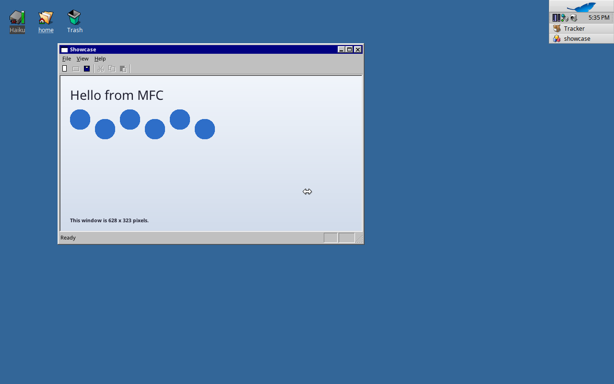
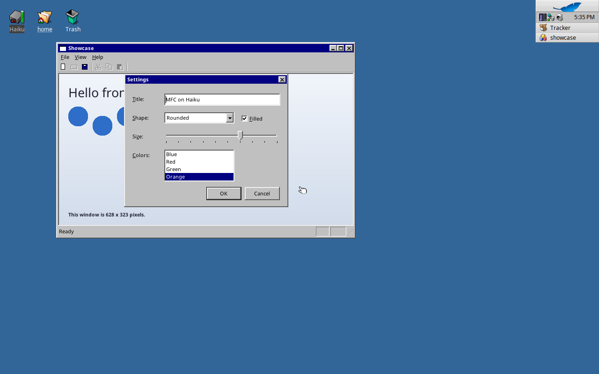
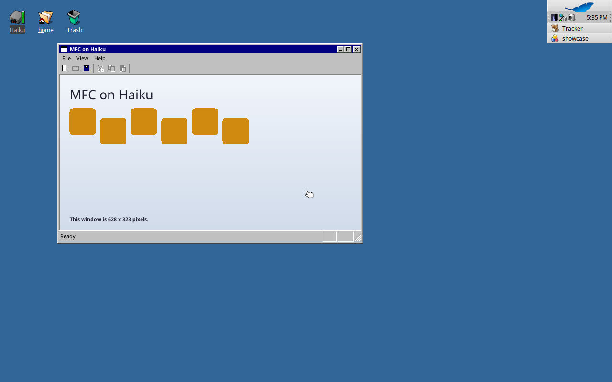
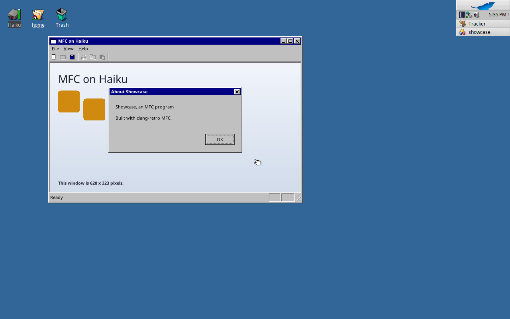

# Haiku

The portable layer and the library build for [Haiku](https://www.haiku-os.org/)
R1 on x86_64 and on 32-bit x86. The windows show with the Haiku backend,
which uses the Be API (`BApplication`, `BWindow`, `BView`, `BBitmap`).

## Requirements

- clang 18 or later, with `ld.lld`. Upstream clang has a Haiku driver.
  You can use the clang of your Linux system.
- A Haiku sysroot. clang-retro/unix-sdk's `haiku/build-sysroot.sh` makes
  one from the packages of Haiku and HaikuPorts. You do not need a copy
  of Haiku:

  ```sh
  unix-sdk/haiku/build-sysroot.sh haiku-sysroot            # x86_64
  ARCH=x86 unix-sdk/haiku/build-sysroot.sh haiku-sysroot32  # 32-bit x86
  ```

## Build the library

```sh
make TARGET=x86_64-unknown-haiku SYSROOT=path/to/haiku-sysroot STDLIB=
make TARGET=i586-pc-haiku SYSROOT=path/to/haiku-sysroot32 STDLIB=
```

The build adds `-D_DEFAULT_SOURCE`, because Haiku declares some BSD and
GNU functions (for example `timegm` and `dl_iterate_phdr`) only with it.
The output is in `build/TARGET`: the static libraries, and the shared
libraries in `build/TARGET/shared`.

## Build a program

```sh
clang++ --target=x86_64-unknown-haiku --sysroot=path/to/haiku-sysroot -fuse-ld=lld \
  -std=c++17 -D_DEFAULT_SOURCE -Ipath/to/mfc/port/include -Ipath/to/mfc/include app.cpp \
  -Lpath/to/mfc/build/x86_64-unknown-haiku -lmfc -lwinport -lbe -lnetwork -lbsd -o app
```

Compile the resources with `port/tools/res2cpp.py`, as on Linux.

## The Haiku backend

The backend has two parts, because the headers of Haiku and the headers
of the portable layer have types and macros with the same names:

| File | Contents |
|---|---|
| `port/src/haiku.h` | the interface between the two parts; it includes no headers of Haiku or of Windows |
| `port/src/backend_haiku_be.cpp` | the part that uses the Be API |
| `port/src/backend_haiku.cpp` | the part that uses the window manager of the layer |

How it works:

- The backend starts a `BApplication` on a thread of its own. The
  signature of the application is `application/x-vnd.winport-NAME`, where
  NAME is the name of the program file.
- Each top-level window is a `BWindow` with no border
  (`B_NO_BORDER_WINDOW_LOOK`). The window manager of the layer draws the
  frame and the caption into the pixels of the window, as on X11 and
  Wayland.
- Menus, tooltips and drop-down lists are floating windows that do not
  take the focus (`B_FLOATING_ALL_WINDOW_FEEL`, `B_AVOID_FOCUS`).
- The layer copies the pixels of a window into a `BBitmap`. A `BView`
  draws the bitmap.
- The window threads put the mouse, keyboard and activation events into
  a queue. The thread of the program takes them from the queue in
  `Wait`.
- The Command key of Haiku (the key with the label Alt on a PC keyboard)
  is Alt. The Option key (the Windows key) is the Windows key.
- The clipboard is `be_clipboard`, with `text/plain`.
- The fonts come from `/boot/system/data/fonts` and the font folders of
  the user. The user interface font is Noto Sans.

Set `WINPORT_BACKEND=headless` to keep the windows in memory, as on
Linux.

## Tests

```sh
make check TARGET=x86_64-unknown-haiku SYSROOT=path/to/haiku-sysroot STDLIB= \
  HAIKU_IMAGE=path/to/haiku-master-x86_64-anyboot.iso
```

`tests/run-haiku-tests.sh` builds the tests and the showcase sample.
With `HAIKU_IMAGE`, it starts Haiku in QEMU with clang-retro/unix-sdk's
`haiku/tools/haiku-vm.py` and runs each test in Haiku. Without
`HAIKU_IMAGE`, it only builds the tests.

| Variable | Default | Meaning |
|---|---|---|
| `HAIKU_IMAGE` | none | an anyboot image of Haiku, for example a nightly image |
| `HAIKU_VM` | `../unix-sdk/haiku/tools/haiku-vm.py` | the VM tool |
| `HAIKU_VM_PORT` | `8765` | the port of the VM tool on the host |
| `HAIKU_VM_RUNNING` | none | `1` to use a `haiku-vm.py serve` that runs already (started with `--files build/TARGET/tests`) |
| `HAIKU_TESTS` | all the tests | the names of the tests to build and run |

The tests run with the headless backend. The showcase sample
(`samples/showcase`) runs with the Haiku backend. It opens its dialogs
by itself and the script keeps a screenshot of each step in
`build/TARGET/tests/shots`.

Without KVM, Haiku takes about five minutes to start in QEMU. With KVM,
it takes less than one minute.

Differences from Linux in the tests:

- The tests run in `/boot/home/mfc`, because `/tmp` is a symbolic link
  in Haiku and some tests compare paths.
- The registry file is not watched with a node monitor. The layer looks
  at the file four times a second.
- `odbctest`, `inettest`, `atlnettest` and `wtltest` are not in the
  list: Haiku has no unixODBC package for the sysroot, and the others
  need a network server or WTL on the host.

## Screenshots

The showcase sample on Haiku (x86_64, nightly hrev60504):








